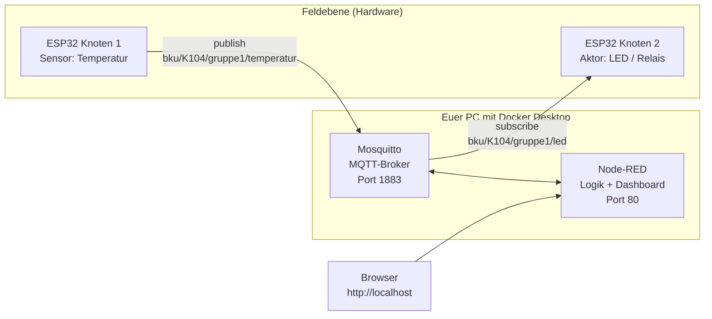

# IIoT-Entwicklungsumgebung (MQTT · Mosquitto · Node-RED)

Diese Umgebung ist eure **Laborumgebung für Industrial-IoT-Projekte** (IIoT) im Bildungsgang Elektrotechnik.
Mit ihr entwickeln wir IoT-Knoten auf Basis des **ESP32**, die Messwerte (z. B. Temperatur, Taster, Füllstand) über **MQTT** verschicken
und Befehle (z. B. LED an/aus, Relais schalten) empfangen. Die Daten werden in **Node-RED** verarbeitet, ausgewertet und in einem Dashboard angezeigt.

Alles, was ihr dafür auf dem PC braucht, startet mit **einem einzigen Befehl** – dank **Docker**.

---

## Inhalt

1. [Das Gesamtbild](#1-das-gesamtbild)
2. [Die Komponenten](#2-die-komponenten)
3. [Was ist Docker – und was ist Docker Compose?](#3-was-ist-docker--und-was-ist-docker-compose)
4. [Installation von Docker Desktop unter Windows](#4-installation-von-docker-desktop-unter-windows)
5. [Die Umgebung starten](#5-die-umgebung-starten)
6. [Erste Schritte: MQTT ausprobieren](#6-erste-schritte-mqtt-ausprobieren)
7. [Einen ESP32 anbinden](#7-einen-esp32-anbinden)
8. [Wichtige Befehle (Spickzettel)](#8-wichtige-befehle-spickzettel)
9. [Fehlersuche](#9-fehlersuche)
10. [Hinweise zur Sicherheit](#10-hinweise-zur-sicherheit)

---

## 1. Das Gesamtbild



Der Datenfluss in Worten:

1. Ein ESP32 misst einen Wert und **veröffentlicht** (*publish*) ihn unter einem **Topic** beim Broker.
2. Der **Broker** (Mosquitto) ist die „Poststelle“: Er nimmt Nachrichten entgegen und verteilt sie an alle, die dieses Topic **abonniert** (*subscribe*) haben.
3. **Node-RED** hat das Topic abonniert, verarbeitet den Wert (z. B. Grenzwert prüfen), zeigt ihn im Dashboard an und kann selbst wieder Nachrichten senden – z. B. an einen zweiten ESP32, der daraufhin eine LED einschaltet.

> **Merke:** Sender und Empfänger kennen sich **nicht**. Sie kennen nur den Broker und das Topic.
> Genau das macht MQTT so flexibel: Ihr könnt jederzeit neue Sensoren oder Auswertungen hinzufügen, ohne die bestehenden Geräte umzuprogrammieren.

---

## 2. Die Komponenten

### 2.1 MQTT – das Protokoll

**MQTT** (*Message Queuing Telemetry Transport*) ist ein schlankes Nachrichtenprotokoll, das speziell für Geräte mit wenig Rechenleistung und unzuverlässigen Netzwerken entwickelt wurde – also perfekt für Mikrocontroller wie den ESP32. MQTT ist in der Industrie (Industrie 4.0) und im Smart Home weit verbreitet.

| Begriff | Bedeutung | Beispiel |
|---|---|---|
| **Broker** | Zentrale Vermittlungsstelle für alle Nachrichten | Mosquitto |
| **Client** | Jedes Gerät/Programm, das mit dem Broker spricht | ESP32, Node-RED |
| **Topic** | „Adresse“ bzw. Kanal einer Nachricht, hierarchisch mit `/` aufgebaut | `bku/K104/gruppe1/temperatur` |
| **Payload** | Der eigentliche Inhalt der Nachricht | `22.5` oder `{"temp":22.5,"hum":40}` |
| **Publish** | Nachricht an ein Topic senden | ESP32 sendet Messwert |
| **Subscribe** | Ein Topic abonnieren, um dessen Nachrichten zu erhalten | Node-RED hört auf Temperatur |
| **QoS** | *Quality of Service*: 0 = höchstens einmal, 1 = mindestens einmal, 2 = genau einmal | meist `0` |
| **Retain** | Broker merkt sich die letzte Nachricht und schickt sie neuen Abonnenten sofort | letzter Schaltzustand |

**Wildcards beim Abonnieren:**

- `+` ersetzt **genau eine** Ebene: `bku/K104/+/temperatur` → Temperatur aller Gruppen
- `#` ersetzt **alle restlichen** Ebenen: `bku/K104/#` → alles aus Raum K104, `#` allein → **alles**

**Unsere Topic-Konvention** (bitte einhalten, damit sich die Gruppen nicht gegenseitig stören):

```
bku/<Raum>/<Gruppe>/<Messgröße oder Aktor>

bku/K104/gruppe1/temperatur
bku/K104/gruppe1/led
bku/K104/gruppe2/taster
```

Topics ohne führenden Schrägstrich schreiben (`bku/...`, nicht `/bku/...`) und auf Umlaute und Leerzeichen verzichten.

### 2.2 Mosquitto – der MQTT-Broker

[Eclipse Mosquitto](https://mosquitto.org/) ist ein kostenloser, sehr verbreiteter MQTT-Broker. In unserer Umgebung läuft er im Container `mosquitto`.

- Erreichbar auf eurem PC unter Port **1883**
- Konfiguration: [mosquitto_config/mosquitto.conf](mosquitto_config/mosquitto.conf)
  ```
  listener 1883          # auf Port 1883 lauschen (alle Netzwerkkarten)
  allow_anonymous true   # Anmeldung ohne Benutzername/Passwort erlaubt
  ```
- Bringt die Kommandozeilenwerkzeuge `mosquitto_pub` (senden) und `mosquitto_sub` (empfangen) mit – ideal zum Testen.

### 2.3 Node-RED – Logik und Dashboard

[Node-RED](https://nodered.org/) ist ein Werkzeug zur **grafischen Programmierung**: Statt Code zu schreiben, verbindet ihr im Browser fertige Bausteine (*Nodes*) zu einem Ablauf (*Flow*). Das erinnert an Funktionsbausteinsprache (FBS/FUP) aus der SPS-Technik.

- Erreichbar im Browser unter **<http://localhost>** (Port 80)
- Dashboard (Bedienoberfläche): **<http://localhost/ui>**
- Alle Flows und Einstellungen liegen im Ordner [nodered_data/](nodered_data/) und bleiben daher auch nach einem Neustart erhalten.

**Bereits installierte Zusatz-Nodes (Palette):**

| Paket | Zweck |
|---|---|
| `node-red-dashboard` | Anzeigen und Bedienelemente (Gauge, Chart, Button, Switch …) |
| `node-red-node-random` | Zufallszahlen – praktisch, um Sensoren zu simulieren |
| `node-red-node-email` | E-Mail-Benachrichtigungen |
| `node-red-node-serialport` | Serielle Schnittstelle (siehe Hinweis unten) |

**Vorhandene Beispiel-Flows (Reiter in Node-RED):**

| Reiter | Inhalt | Status |
|---|---|---|
| **Grundlagen** | Inject, Debug, Switch, Range, Change, Delay … | deaktiviert |
| **TCP Tipps** | TCP-Kommunikation mit Dashboard-Anzeige | deaktiviert |
| **ARD und Serial** | Arduino-Werte über die serielle Schnittstelle einlesen | deaktiviert |
| **Flow 1** | Minimalbeispiel MQTT senden/empfangen | **aktiv** |
| **Gefahrgut Benachrichtigung** | MQTT-Auswertung mit E-Mail-Alarm (Fallbeispiel) | deaktiviert |

Einen deaktivierten Reiter aktiviert ihr per Doppelklick auf den Reiter → Schalter *Enabled* → **Deploy**.

> **Hinweis Seriell:** Unter Docker Desktop für Windows kann ein Container **nicht** auf COM-Schnittstellen zugreifen. Der Reiter *ARD und Serial* funktioniert daher nur mit einer lokal (ohne Docker) installierten Node-RED-Version. Für unsere ESP32-Projekte brauchen wir das nicht – die ESP32 kommunizieren per WLAN und MQTT.

> **Wichtig – Broker-Adresse in Node-RED:** Node-RED läuft *selbst* in einem Container. `localhost` bedeutet dort „dieser Container“ – und dort läuft kein Broker! Tragt im MQTT-Broker-Node deshalb **`mosquitto`** (Containername) oder **`192.168.101.20`** ein. Der bereits angelegte Broker-Node `IIOTBroker` ist korrekt eingestellt.

---

## 3. Was ist Docker – und was ist Docker Compose?

### 3.1 Das Problem

Ohne Docker müsstet ihr Mosquitto und Node-RED (inkl. Node.js) einzeln herunterladen, installieren und konfigurieren – mit unterschiedlichen Versionen, Pfaden und Fehlerquellen auf jedem Rechner. „Bei mir läuft’s aber …“ ist die Folge.

### 3.2 Die Lösung: Container

**Docker** verpackt eine Anwendung samt allem, was sie zum Laufen braucht (Bibliotheken, Laufzeitumgebung, Konfiguration), in einen **Container**. Ein Container läuft auf jedem Rechner mit Docker **gleich** – egal ob Windows, Linux oder macOS.

Ein Vergleich aus der Elektrotechnik: Ein Container ist wie ein **Hutschienenmodul**. Es bringt seine eigene Elektronik mit, hat definierte Anschlüsse (Ports) und wird einfach in die Verteilung (Docker) eingeklinkt – egal, wer das Modul gebaut hat.

| Begriff | Erklärung | Analogie |
|---|---|---|
| **Image** | Unveränderliche Vorlage/Bauplan einer Anwendung, wird aus dem Internet (Docker Hub) geladen | Datenblatt + Bauteil im Lager |
| **Container** | Eine laufende Instanz eines Images | Eingebautes, eingeschaltetes Modul |
| **Port-Weiterleitung** | Verbindet einen Port des PCs mit einem Port im Container, z. B. `80:1880` | Klemme am Gehäuse, die nach innen durchverbunden ist |
| **Volume / Bind-Mount** | Ordner auf dem PC, der in den Container eingeblendet wird – Daten bleiben erhalten, auch wenn der Container gelöscht wird | Externer Speicher, der beim Modultausch bleibt |
| **Netzwerk** | Virtuelles Netz, in dem Container miteinander sprechen | Interner Feldbus |

**Container ≠ virtuelle Maschine:** Eine VM emuliert einen kompletten Rechner mit eigenem Betriebssystem. Container teilen sich den Betriebssystemkern und sind dadurch viel kleiner und starten in Sekunden.

### 3.3 Docker Compose

Unsere Umgebung besteht aus **zwei** Containern, die zusammenarbeiten müssen. Statt jeden Container mit einem langen `docker run …`-Befehl einzeln zu starten, beschreibt man das ganze System in **einer Datei**: der [docker-compose.yml](docker-compose.yml). Mit `docker compose up -d` wird alles gemeinsam gestartet.

So ist unsere `docker-compose.yml` aufgebaut (gekürzt und kommentiert):

```yaml
name: iiot                                # Projektname

networks:
  iiot-network:                           # eigenes virtuelles Netzwerk
    driver: bridge
    ipam:
      config:
        - subnet: 192.168.101.0/24        # Adressbereich im Docker-Netz

services:                                 # die einzelnen Container
  nodered:
    image: nodered/node-red:latest        # welches Image?
    container_name: nodered
    restart: unless-stopped               # nach PC-Neustart automatisch wieder starten
    networks:
      iiot-network:
        ipv4_address: 192.168.101.10      # feste IP im Docker-Netz
    ports:
      - "80:1880"                         # PC-Port 80  ->  Container-Port 1880
    volumes:
      - ./nodered_data:/data              # PC-Ordner   ->  Ordner im Container

  mosquitto:
    image: eclipse-mosquitto:latest
    container_name: mosquitto
    restart: unless-stopped
    networks:
      iiot-network:
        ipv4_address: 192.168.101.20
    ports:
      - "1883:1883"                       # MQTT-Port nach außen freigeben
    volumes:
      - ./mosquitto_config:/mosquitto/config
      - ./mosquitto_data:/mosquitto/data
      - ./mosquitto_log:/mosquitto/log
```

Die Schreibweise bei `ports` und `volumes` ist immer **`PC : Container`** (links euer Rechner, rechts der Container).

---

## 4. Installation von Docker Desktop unter Windows

**Docker Desktop** ist das Programm, das Docker unter Windows bereitstellt (inklusive grafischer Oberfläche und dem Befehl `docker compose`). Für Bildungszwecke und private Nutzung ist es kostenlos.

### 4.1 Voraussetzungen

- Windows 10 (64 Bit, Version 22H2) oder Windows 11
- Mindestens 8 GB RAM empfohlen
- **Virtualisierung im BIOS/UEFI aktiviert** (Intel VT-x bzw. AMD-V/SVM).
  Prüfen: Task-Manager → Leistung → CPU → „Virtualisierung: **Aktiviert**“
- Administratorrechte für die Installation

### 4.2 Schritt 1: WSL 2 installieren

Docker Desktop nutzt unter Windows das **Windows-Subsystem für Linux (WSL 2)**, weil die Container eigentlich Linux-Programme sind.

1. **PowerShell als Administrator** öffnen (Startmenü → „PowerShell“ → Rechtsklick → *Als Administrator ausführen*).
2. Eingeben:
   ```powershell
   wsl --install
   ```
3. PC **neu starten**.
4. Kontrolle (normale PowerShell):
   ```powershell
   wsl --status
   ```
   Hier sollte als Standardversion **2** angezeigt werden. Falls WSL schon installiert war, hilft `wsl --update`.

### 4.3 Schritt 2: Docker Desktop installieren

**Variante A – Download:**
1. Installer von <https://www.docker.com/products/docker-desktop/> herunterladen („Download for Windows – AMD64“).
2. Installer ausführen, Option **„Use WSL 2 instead of Hyper-V“** angehakt lassen.
3. Nach der Installation abmelden/neu starten, falls verlangt.

**Variante B – per Kommandozeile (winget):**
```powershell
winget install -e --id Docker.DockerDesktop
```

### 4.4 Schritt 3: Docker Desktop starten und prüfen

1. Docker Desktop aus dem Startmenü starten und die Lizenzbedingungen akzeptieren. Eine Anmeldung bzw. ein Docker-Konto ist **nicht** nötig („Skip“/„Continue without signing in“).
2. Warten, bis unten links in Docker Desktop **„Engine running“** (grün) steht. Das Wal-Symbol in der Taskleiste zeigt ebenfalls den Status.
3. In einer PowerShell testen:
   ```powershell
   docker version
   docker compose version
   docker run --rm hello-world
   ```
   Erscheint bei `hello-world` die Meldung *„Hello from Docker!“*, ist alles bereit.

> **Tipp:** Unter *Settings → General* kann man „Start Docker Desktop when you sign in“ aktivieren. Dann laufen die IIoT-Container nach jedem PC-Start automatisch.

---

## 5. Die Umgebung starten

### 5.1 Projekt herunterladen

**Mit Git:**
```powershell
git clone https://github.com/DaveWob/IIOT-devenv.git
cd IIOT-devenv
```

**Ohne Git:** Auf GitHub oben rechts auf **Code → Download ZIP** klicken, ZIP entpacken und den Ordner öffnen.

> Tipp: Den Ordner in **Visual Studio Code** öffnen. Dort habt ihr mit *Terminal → Neues Terminal* gleich eine Kommandozeile im richtigen Verzeichnis.

### 5.2 Container starten

Im Projektordner (dort, wo die `docker-compose.yml` liegt):

```powershell
docker compose up -d
```

- `up` = Container erzeugen und starten
- `-d` = *detached*, die Container laufen im Hintergrund weiter

Beim ersten Start werden die Images aus dem Internet geladen (einige hundert MB) – das dauert einen Moment.

### 5.3 Kontrolle

```powershell
docker compose ps
```

Beide Container (`nodered`, `mosquitto`) sollten den Status **running** bzw. **Up** haben. Alternativ seht ihr sie in Docker Desktop unter *Containers* in der Gruppe **iiot**.

Jetzt im Browser öffnen:

| Was | Adresse |
|---|---|
| Node-RED Editor | <http://localhost> |
| Node-RED Dashboard | <http://localhost/ui> |
| MQTT-Broker (für Clients) | `localhost:1883` bzw. `<IP-eures-PCs>:1883` |

---

## 6. Erste Schritte: MQTT ausprobieren

### 6.1 Mit der Kommandozeile im Mosquitto-Container

Öffnet **zwei** PowerShell-Fenster.

**Fenster 1 – alles mitlesen** (Abonnent):
```powershell
docker exec -it mosquitto mosquitto_sub -t "#" -v
```
`-t "#"` abonniert alle Topics, `-v` zeigt zusätzlich das Topic an.

**Fenster 2 – eine Nachricht senden** (Herausgeber):
```powershell
docker exec -it mosquitto mosquitto_pub -t "bku/K104/gruppe1/temperatur" -m "22.5"
```

In Fenster 1 erscheint:
```
bku/K104/gruppe1/temperatur 22.5
```

Beenden mit `Strg + C`.

### 6.2 Mit Node-RED

1. <http://localhost> öffnen.
2. Aus der Palette links einen **mqtt in**-Node und einen **debug**-Node in den Arbeitsbereich ziehen und verbinden.
3. Doppelklick auf **mqtt in**: Server `IIOTBroker` auswählen (bzw. neu anlegen mit Server `mosquitto`, Port `1883`), Topic `bku/K104/#`.
4. Oben rechts **Deploy** klicken.
5. Rechts den Reiter **Debug** (Käfer-Symbol) öffnen und mit `mosquitto_pub` (siehe oben) eine Nachricht senden – sie erscheint im Debug-Fenster.

Danach einen **inject**- und einen **mqtt out**-Node ausprobieren: Damit sendet Node-RED selbst Nachrichten, z. B. `on`/`off` an `bku/K104/gruppe1/led`.

### 6.3 Optional: MQTT Explorer

Sehr empfehlenswert zum Beobachten aller Topics ist das kostenlose Programm **[MQTT Explorer](https://mqtt-explorer.com/)**. Verbinden mit Host `localhost`, Port `1883`, ohne Benutzername/Passwort.

---

## 7. Einen ESP32 anbinden

### 7.1 Netzwerk – das Wichtigste zuerst

Der ESP32 muss den Broker auf **eurem PC** erreichen. Dafür gilt:

- **`localhost` funktioniert auf dem ESP32 nicht!** Ihr braucht die **IP-Adresse des PCs** im WLAN/LAN. Ermitteln mit:
  ```powershell
  ipconfig
  ```
  → IPv4-Adresse des WLAN- bzw. Ethernet-Adapters, z. B. `192.168.178.42`.
  (Die Adressen `192.168.101.x` gelten nur **innerhalb** des Docker-Netzwerks und sind vom ESP32 aus nicht erreichbar.)
- PC und ESP32 müssen im **selben Netzwerk** sein. In manchen Schul- oder Gäste-WLANs sind Geräte voneinander abgeschottet („Client Isolation“) – dann einen eigenen Router oder einen Handy-Hotspot verwenden.
- Die **Windows-Firewall** muss eingehende Verbindungen auf Port **1883** erlauben. Beim ersten Start fragt Windows meist nach – „Zulassen“ wählen (privates Netzwerk). Andernfalls (PowerShell als Administrator):
  ```powershell
  New-NetFirewallRule -DisplayName "MQTT 1883" -Direction Inbound -Protocol TCP -LocalPort 1883 -Action Allow -Profile Private
  ```

### 7.2 Bibliothek in der Arduino IDE

*Werkzeuge → Bibliotheken verwalten* → nach **PubSubClient** (von Nick O'Leary) suchen und installieren.

### 7.3 Beispiel-Sketch

Der ESP32 sendet alle 5 Sekunden einen Messwert und schaltet die eingebaute LED per MQTT-Befehl.

```cpp
#include <WiFi.h>
#include <PubSubClient.h>

// ---------- Anpassen ----------
const char* WLAN_SSID     = "MeinWLAN";
const char* WLAN_PASSWORT = "geheim";
const char* MQTT_SERVER   = "192.168.178.42";   // IP eures PCs (ipconfig)
const int   MQTT_PORT     = 1883;

const char* TOPIC_WERT = "bku/K104/gruppe1/temperatur";
const char* TOPIC_LED  = "bku/K104/gruppe1/led";
const int   LED_PIN    = 2;                     // eingebaute LED bei vielen ESP32-Boards
// ------------------------------

WiFiClient   wlanClient;
PubSubClient mqtt(wlanClient);
unsigned long letzteMessung = 0;

// Wird aufgerufen, wenn eine Nachricht auf einem abonnierten Topic eintrifft
void nachrichtEmpfangen(char* topic, byte* payload, unsigned int laenge) {
  String nachricht;
  for (unsigned int i = 0; i < laenge; i++) nachricht += (char)payload[i];

  Serial.printf("Empfangen [%s]: %s\n", topic, nachricht.c_str());

  if (String(topic) == TOPIC_LED) {
    digitalWrite(LED_PIN, nachricht == "on" ? HIGH : LOW);
  }
}

void wlanVerbinden() {
  Serial.print("Verbinde mit WLAN ");
  WiFi.begin(WLAN_SSID, WLAN_PASSWORT);
  while (WiFi.status() != WL_CONNECTED) {
    delay(500);
    Serial.print(".");
  }
  Serial.print(" OK, IP: ");
  Serial.println(WiFi.localIP());
}

void mqttVerbinden() {
  while (!mqtt.connected()) {
    // Jede Client-ID muss am Broker eindeutig sein -> MAC-Adresse anhängen
    String clientId = "esp32-" + String((uint32_t)ESP.getEfuseMac(), HEX);
    Serial.print("Verbinde mit MQTT-Broker ... ");
    if (mqtt.connect(clientId.c_str())) {
      Serial.println("OK");
      mqtt.subscribe(TOPIC_LED);
    } else {
      Serial.printf("Fehler (rc=%d), neuer Versuch in 2 s\n", mqtt.state());
      delay(2000);
    }
  }
}

void setup() {
  Serial.begin(115200);
  pinMode(LED_PIN, OUTPUT);
  wlanVerbinden();
  mqtt.setServer(MQTT_SERVER, MQTT_PORT);
  mqtt.setCallback(nachrichtEmpfangen);
}

void loop() {
  if (!mqtt.connected()) mqttVerbinden();
  mqtt.loop();                                  // regelmäßig aufrufen!

  if (millis() - letzteMessung > 5000) {
    letzteMessung = millis();
    float wert = 20.0 + random(0, 100) / 10.0;  // Platzhalter für einen echten Sensor
    char text[16];
    dtostrf(wert, 4, 1, text);
    mqtt.publish(TOPIC_WERT, text);
    Serial.printf("Gesendet [%s]: %s\n", TOPIC_WERT, text);
  }
}
```

**Testen:** Im Mosquitto-Container mitlesen (`mosquitto_sub -t "#" -v`) und die LED schalten:
```powershell
docker exec -it mosquitto mosquitto_pub -t "bku/K104/gruppe1/led" -m "on"
docker exec -it mosquitto mosquitto_pub -t "bku/K104/gruppe1/led" -m "off"
```

Wenn das klappt, übernimmt Node-RED diese Aufgabe: Werte im Dashboard als Gauge/Chart anzeigen und die LED über einen Dashboard-Switch schalten.

---

## 8. Wichtige Befehle (Spickzettel)

Alle `docker compose`-Befehle im Projektordner ausführen.

| Befehl | Wirkung |
|---|---|
| `docker compose up -d` | Container erzeugen und im Hintergrund starten |
| `docker compose ps` | Status der Container anzeigen |
| `docker compose stop` | Container anhalten (bleiben erhalten) |
| `docker compose start` | Angehaltene Container wieder starten |
| `docker compose restart` | Container neu starten (z. B. nach Änderung der `mosquitto.conf`) |
| `docker compose down` | Container und Netzwerk **löschen** – eure Daten in den Ordnern bleiben erhalten |
| `docker compose logs -f` | Protokollausgaben live anzeigen (Beenden: `Strg + C`) |
| `docker compose logs -f nodered` | … nur von Node-RED |
| `docker compose pull` | Neueste Images herunterladen (danach `up -d`) |
| `docker exec -it mosquitto sh` | Kommandozeile **im** Mosquitto-Container öffnen (`exit` zum Verlassen) |
| `docker exec -it mosquitto mosquitto_sub -t "#" -v` | Alle MQTT-Nachrichten mitlesen |
| `docker exec -it mosquitto mosquitto_pub -t "<topic>" -m "<text>"` | MQTT-Nachricht senden |

### Ordnerstruktur

```
.
├── docker-compose.yml       # Beschreibung der gesamten Umgebung
├── mosquitto_config/
│   └── mosquitto.conf       # Konfiguration des Brokers
├── mosquitto_data/          # Persistente Daten des Brokers (z. B. retained messages)
├── mosquitto_log/           # Logdateien des Brokers
└── nodered_data/            # Alles von Node-RED: Flows, Einstellungen, Zusatz-Nodes
    ├── flows.json           # eure Flows
    ├── settings.js          # Node-RED-Einstellungen
    ├── package.json         # Liste der installierten Zusatz-Nodes
    └── node_modules/        # die Zusatz-Nodes selbst
```

> **Sichern:** Eure Arbeit steckt in `nodered_data/flows.json`. Zusätzlich könnt ihr in Node-RED über *Menü (☰) → Export* einzelne Flows als JSON speichern und weitergeben.

---

## 9. Fehlersuche

| Problem | Ursache / Lösung |
|---|---|
| `docker: command not found` / „Der Befehl docker wurde nicht gefunden“ | Docker Desktop nicht installiert oder nicht gestartet. Terminal nach der Installation neu öffnen. |
| `error during connect … pipe/dockerDesktopLinuxEngine` | Docker Desktop läuft nicht. Starten und warten, bis „Engine running“ angezeigt wird. |
| Docker Desktop meldet „Virtualization support not detected“ / WSL-Fehler | Virtualisierung im BIOS aktivieren; `wsl --update` ausführen; PC neu starten. |
| `Bind for 0.0.0.0:80 failed: port is already allocated` | Port 80 ist schon belegt (z. B. durch IIS, Skype oder einen anderen Webserver). In der `docker-compose.yml` `"80:1880"` auf `"8080:1880"` ändern, `docker compose up -d` ausführen und Node-RED unter <http://localhost:8080> öffnen. |
| Port 1883 belegt | Läuft lokal noch ein anderer Mosquitto (z. B. als Windows-Dienst)? Diesen beenden. |
| `Pool overlaps with other one on this address space` | Das Netz `192.168.101.0/24` existiert bereits (z. B. euer Heimnetz). In der `docker-compose.yml` Subnetz **und** die beiden festen IPs auf z. B. `192.168.201.x` ändern – und dann auch die Broker-Adresse in Node-RED anpassen. |
| Node-RED-MQTT-Node bleibt auf „connecting“ | Als Broker-Adresse wurde `localhost` eingetragen → `mosquitto` oder `192.168.101.20` verwenden. |
| ESP32 verbindet sich nicht mit dem Broker (`rc=-2`) | Falsche PC-IP, ESP32 nicht im selben Netz, Firewall blockiert Port 1883, oder Container läuft nicht. Erst mit MQTT Explorer von einem anderen Gerät testen. |
| ESP32 verbindet sich ständig neu | Zwei Geräte nutzen dieselbe Client-ID → eindeutige ID verwenden (siehe Sketch). |
| Änderungen an `mosquitto.conf` wirken nicht | `docker compose restart mosquitto` |

---

## 10. Hinweise zur Sicherheit

Diese Umgebung ist bewusst **einfach** gehalten und nur für das **Labor/Unterrichtsnetz** gedacht:

- Der Broker erlaubt **anonyme Verbindungen** ohne Passwort und ohne Verschlüsselung (`allow_anonymous true`).
- Der Node-RED-Editor ist **ohne Anmeldung** erreichbar – jeder im selben Netz kann eure Flows ändern.

Die Ports **niemals** über den Router ins Internet freigeben! In echten Industrieanlagen werden MQTT-Verbindungen mit Benutzerkonten, Zugriffsrechten (ACLs) und TLS-Verschlüsselung (Port 8883) abgesichert – das ist ein mögliches Thema für später.

---

**Weiterführende Links**

- MQTT-Grundlagen: <https://www.hivemq.com/mqtt/>
- Mosquitto-Dokumentation: <https://mosquitto.org/documentation/>
- Node-RED-Dokumentation: <https://nodered.org/docs/>
- Docker-Einstieg: <https://docs.docker.com/get-started/>
- PubSubClient-Bibliothek: <https://pubsubclient.knolleary.net/>
